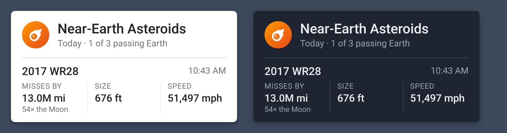

# MMM-NEO

**Near-Earth asteroids passing our planet today**, for [MagicMirror²](https://magicmirror.builders/), from NASA's NeoWs data.

Have you ever wondered how many Near Earth Objects are passing our planet every day? How big are they? How fast are they travelling? Are they potentially dangerous? Be afraid. Be VERY afraid!



The title stays at the top. Below it, one asteroid at a time fades in, closest pass first, and switches to the next every 20 seconds. The card stays the same size however many asteroids pass that day.

Each asteroid shows:

- its name, and a red **Hazardous** label if NASA flags it as potentially hazardous
- the time it passes closest to Earth (in your time zone)
- how far it misses Earth, also shown as a multiple of the distance to the Moon
- its estimated size and its speed

Comes in **white** and **dark**, matching [MMM-NOAAV4](https://github.com/cowboysdude/MMM-NOAAV4).

---

## Install

```bash
cd ~/MagicMirror/modules
git clone https://github.com/cowboysdude/MMM-NEO
```

No `npm install` needed. No API key needed either (see `apiKey` below).

## Config

Add this to the `modules` list in `~/MagicMirror/config/config.js`:

```js
{
  module: "MMM-NEO",
  position: "top_right",
  config: {
    css: "light"      // "light" = white card, "dark" = dark card
  }
},
```

| Option | Default | What it does |
|---|---|---|
| `css` | `"light"` | `"light"` = white card. `"dark"` = dark card. `""` = the original plain text look (see below). |
| `width` | `330` | Card width in pixels. |
| `rotateInterval` | `20000` | How often to show the next asteroid, in milliseconds (`20 * 1000` = 20 seconds). |
| `header` | `""` | Your own title instead of "Near-Earth Asteroids". |
| `units` | your config's `units` | `"imperial"` = miles, feet and mph. `"metric"` = km, meters and km/h. |
| `showAll` | `false` | `true` = list all of today's asteroids at once instead of one at a time (the card grows with the list). |
| `maxObjects` | `6` | With `showAll: true`, the most asteroids to list. |
| `apiKey` | `""` | Your own free NASA key from https://api.nasa.gov. Empty = NASA's shared `DEMO_KEY`. |
| `updateInterval` | `3600000` | How often to ask NASA for new data, in milliseconds (once an hour). Leave it, because `DEMO_KEY` is limited. |

### Plain text look (`css: ""`)

The original look: white text, no card. These options only apply to it:

| Option | Default | What it does |
|---|---|---|
| `maxWidth` | `"275px"` | Width of the module. |
| `useHeader` | `false` | Show a MagicMirror header above the module (text from `header`). |
| `showCount` | `true` | The "1 of 3 passing Earth today" line. |
| `animationSpeed` | `3000` | Fade between asteroids, in milliseconds. |

---

## Troubleshooting

| What you see | Fix |
|---|---|
| "Loading…" never goes away | Restart MagicMirror (not just a page refresh). Check the terminal for lines starting with `[MMM-NEO]`. |
| "NASA data not available right now" | NASA couldn't be reached. It tries again on its own every hour. |
| `[MMM-NEO] NASA answered 429` in the terminal | The shared `DEMO_KEY` hit its limit. Get a free key at https://api.nasa.gov and set `apiKey`. |
| "None passing today" | NASA lists no asteroids for today. |
| A dark box around the card | If you use [MMM-WeatherBackgroundV4](https://github.com/cowboysdude/MMM-WeatherBackgroundV4), it already skips MMM-NEO. If you set your own `noBox` list there, add `"MMM-NEO"` to it. |

Voice control: send the `HIDE_NEO` or `SHOW_NEO` notification.

---

## What changed in this version

- **New card look** (white or dark), with a meteor badge and today's count.
- **One asteroid at a time:** the title stays put and only the asteroid fades to the next. `showAll: true` lists them all.
- **Fixed:** wouldn't start on current MagicMirror. It needed the old `request` package, which MagicMirror no longer includes; it now uses built-in `fetch`.
- **Fixed:** stopped showing asteroids after midnight (it never noticed the date changed).
- **Fixed:** crashed on a day with no asteroids.
- Closest pass first, miss distance in Moon distances, miles/feet/mph with imperial units, numbers with commas, and an optional `apiKey`.

## Credits

Data: NASA [NeoWs](https://api.nasa.gov) (Near Earth Object Web Service).
Original module by [Mykle1](https://github.com/mykle1/MMM-NEO). Updated by cowboysdude. MIT License.

Special thanks to NASA's NEO team and SpaceCowboysDude.
